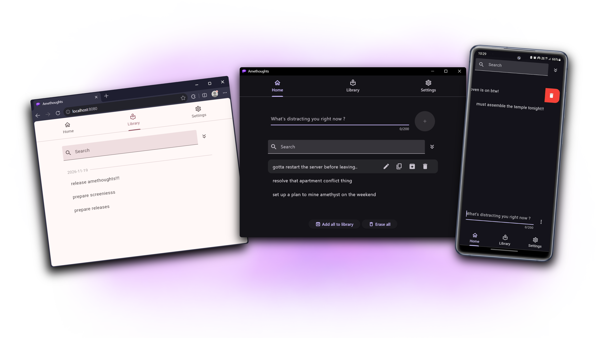
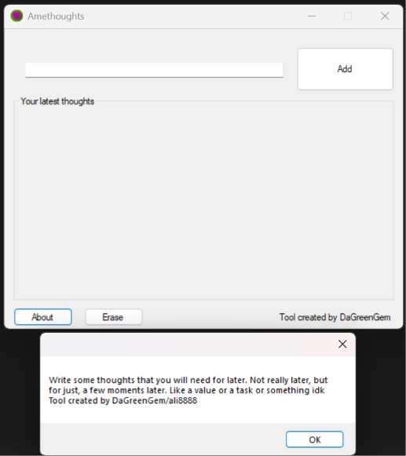

<h1 align="left">
   
    &nbsp; Amethoughts
</h1>

A productivity tool that aims to help you minimize your distractions in order to focus on your work. Now available for Windows, MacOS (untested), Linux, Web and Android.

It's simple : The moment that some random unrelated thought crosses your mind, you write it down in Amethoughts, and resume your work without wasting a second nor worrying about forgetting it.

> *Wait, can I not just do this with any note taking app ?*

Amethoughts's process is slightly different :

- You can describe thoughts *briefly* into Amethoughts, come back later in order to read/remember them, then close it directly **without a confirmation dialog** or any other obstacles. Additionally, those thoughts get removed as Amethoughts served its purpose of preventing you from forgetting them during your work session. The result being that : 
1. You know that the list of thoughts you see is from your current session.
2. You don't have to worry about any growing pile of content being littered around in your device.
3. It's like writing on something that's getting shredded later, except that you don't need to shred anything.

- If you wish to keep certain thoughts, you can just add them to a separate library of persistent thoughts. These thoughts remain forever and are auto-saved, so you don't have to worry about picking a location to save them in. Amethoughts also keeps track of the day you wrote them down, and allows you to search through them easily. Moreover, you could use this as a time capsule to look into unusual things your mind was on about.

This process allows you to maximize your focus by minimizing the time it takes for you to write something. You should also keep it displayed at all times so that it only takes 1-2 click(s) total to write a thought.

**Recommendation :** Use this alongside Windows's focus sessions for a productivity boost!

### Future content :

I also plan to improve and add more features to Amethoughts soon™, like :

- More kinds of writable content aside from text (Images, links, etc.)
- Filters for the library
- Other languages

**Fun Fact :** This is actually a remaster of an old app I made back in 2018. Though since it was made in WinForms, it was exclusive to Windows.

